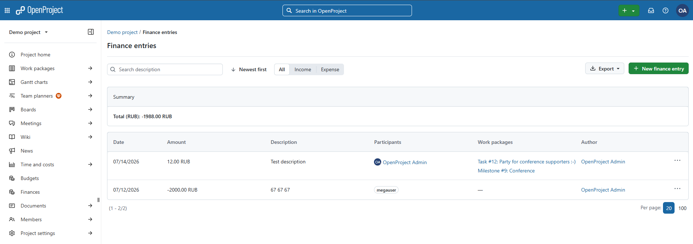
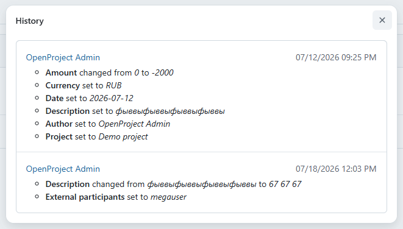
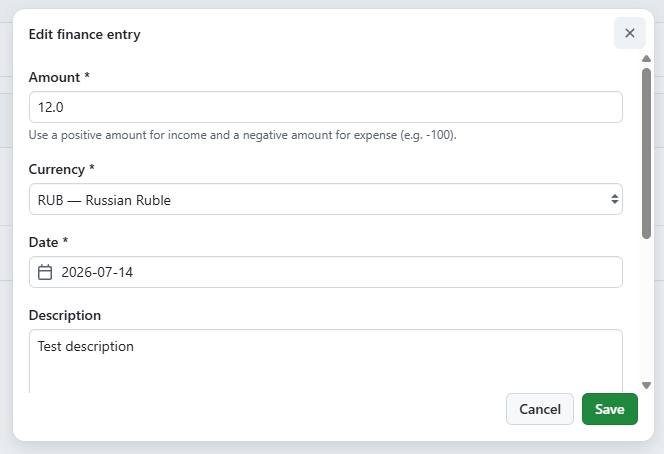

# OpenProject Finances

[English](README.md) | [Русский](README_RU.md)

An OpenProject plugin for maintaining a project-level income and expense
ledger. It supports multiple currencies, Central Bank of Russia (CBR)
exchange rates, project members and external participants, work package
links, history, filtering, pagination, and CSV/XLS exports.

## Main features

- Project-level income and expense ledger with signed amounts.
- Multi-currency entries and an automatically synchronized CBR currency
  catalog.
- Automatic conversion to RUB using locally stored historical CBR rates.
- Links to OpenProject work packages and project members.
- Support for external participants who do not have an OpenProject account.
- Entry history with author, timestamp, and association snapshots.
- Filtering by entry type, participant, work package, project, and other
  finance attributes.
- Currency totals, pagination, and CSV/XLS exports.
- Separate permissions for viewing, creating, editing, and deleting entries.
- Background currency and exchange-rate synchronization every 30 minutes.

## Screenshots

### Finance overview



### Entry history



### Create or edit entry



## Compatibility

- OpenProject `>= 16.0.0`
- Ruby `>= 3.4`

## Installation

Follow the general
[OpenProject plugin installation documentation](https://www.openproject.org/docs/installation-and-operations/configuration/plugins/).

Add the plugin to `Gemfile.plugins` in your OpenProject installation. Pinning
a release tag is recommended for reproducible production builds:

```ruby
group :opf_plugins do
  gem "openproject-finances",
      git: "https://github.com/reygasai/openproject-finances.git",
      tag: "v0.1.0"
end
```

Install the bundle and apply the plugin migrations:

```bash
bundle install
bundle exec rails db:migrate
```

When OpenProject is installed with Docker, these commands belong in the
custom image build. The resulting image must be used by the `web`, `worker`,
`cron`, and `seeder` services. Rebuild the image whenever the plugin version
changes; do not copy plugin files into running production containers.

Restart OpenProject after installation. Then:

1. Enable **Finances** in **Project settings → Modules**.
2. Grant the required finance permissions to project roles.

## Permissions

The plugin adds four project permissions:

- View finance entries
- Create finance entries
- Edit finance entries
- Delete finance entries

Create, edit, and delete permissions depend on view permission.

## Exchange rates

The plugin stores CBR rates locally and registers `FinanceCbrSyncJob` to run
every 30 minutes. The OpenProject `cron` and `worker` services must be
running, and the containers need outbound HTTPS access to `cbr.ru`.

RUB is created by the database migration because it is not present in the
CBR foreign-currency catalog.

## Updating

Change the tag in `Gemfile.plugins`, rebuild the OpenProject image, and run
the database migrations:

```ruby
gem "openproject-finances",
    git: "https://github.com/reygasai/openproject-finances.git",
    tag: "v0.2.0"
```

```bash
bundle install
bundle exec rails db:migrate
```

Back up the OpenProject database and attachments before updating.

## Development and tests

For local development, clone this repository into an OpenProject checkout:

```bash
git clone https://github.com/reygasai/openproject-finances.git \
  plugins/openproject-finances
```

Use a path entry in the checkout's `Gemfile.plugins`:

```ruby
group :opf_plugins do
  gem "openproject-finances", path: "plugins/openproject-finances"
end
```

After installing the OpenProject bundle, run the plugin specs from the
OpenProject root:

```bash
bundle exec rspec plugins/openproject-finances/spec
```

In the Docker Compose development stack:

```bash
docker compose exec web \
  bundle exec rspec plugins/openproject-finances/spec
```

## AI-assisted development

This plugin was developed by reygasai with AI assistance, primarily using
**GPT-5.6 Sol** and **Grok 4.5**. AI tools were used during implementation,
debugging, testing, and documentation; the project author directed the work
and reviewed the resulting changes.

## License

OpenProject Finances is released under the
[GNU General Public License v3.0](LICENSE).
