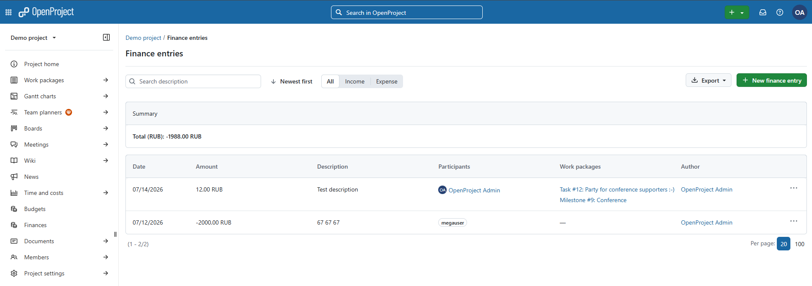
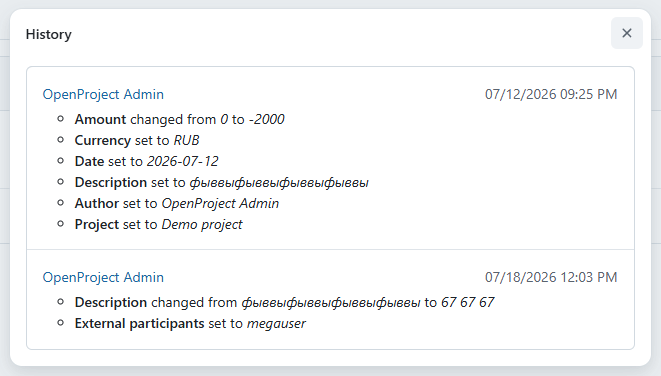
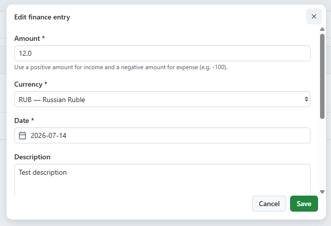

# OpenProject Finances

[English](README.md) | [Русский](README_RU.md)

Плагин OpenProject для ведения доходов и расходов на уровне проекта.
Поддерживает несколько валют, курсы Центрального банка России (ЦБ РФ),
участников проекта и внешних участников, связь с пакетами работ, историю
изменений, фильтрацию, пагинацию и экспорт в CSV/XLS.

## Основные возможности

- Учёт доходов и расходов проекта с помощью положительных и отрицательных сумм.
- Операции в разных валютах и автоматическая синхронизация справочника валют ЦБ РФ.
- Автоматический пересчёт в рубли по сохранённым историческим курсам ЦБ РФ.
- Связь финансовых операций с пакетами работ и участниками проекта.
- Поддержка внешних участников без учётной записи OpenProject.
- История операций с автором, временем изменения и снимками связанных сущностей.
- Фильтрация по типу операции, участнику, пакету работ, проекту и другим полям.
- Итоги по валютам, пагинация и экспорт в CSV/XLS.
- Отдельные права на просмотр, создание, редактирование и удаление операций.
- Фоновая синхронизация валют и курсов каждые 30 минут.

## Скриншоты

### Главный экран финансов



### История операции



### Создание или редактирование операции



## Совместимость

- OpenProject `>= 16.0.0`
- Ruby `>= 3.4`

## Установка

Используйте общую
[инструкцию по установке плагинов OpenProject](https://www.openproject.org/docs/installation-and-operations/configuration/plugins/).

Добавьте плагин в `Gemfile.plugins` вашей установки OpenProject. Для
воспроизводимых production-сборок рекомендуется фиксировать тег релиза:

```ruby
group :opf_plugins do
  gem "openproject-finances",
      git: "https://github.com/reygasai/openproject-finances.git",
      tag: "v0.1.0"
end
```

Установите зависимости и примените миграции плагина:

```bash
bundle install
bundle exec rails db:migrate
```

При установке OpenProject через Docker эти команды должны выполняться во
время сборки собственного образа. Полученный образ необходимо использовать
для сервисов `web`, `worker`, `cron` и `seeder`. После изменения версии
плагина пересоберите образ; не копируйте файлы плагина непосредственно в
работающие production-контейнеры.

После установки перезапустите OpenProject, затем:

1. Включите модуль **Finances** в разделе **Настройки проекта → Модули**.
2. Выдайте ролям проекта необходимые права для работы с финансами.

## Права доступа

Плагин добавляет четыре права на уровне проекта:

- Просмотр финансовых операций
- Создание финансовых операций
- Редактирование финансовых операций
- Удаление финансовых операций

Права на создание, редактирование и удаление зависят от права на просмотр.

## Курсы валют

Плагин сохраняет курсы ЦБ РФ локально и регистрирует задачу
`FinanceCbrSyncJob`, которая запускается каждые 30 минут. Сервисы OpenProject
`cron` и `worker` должны быть запущены, а контейнерам необходим исходящий
HTTPS-доступ к `cbr.ru`.

Рубль создаётся миграцией базы данных, поскольку его нет в справочнике
иностранных валют ЦБ РФ.

## Обновление

Измените тег в `Gemfile.plugins`, пересоберите образ OpenProject и примените
миграции базы данных:

```ruby
gem "openproject-finances",
    git: "https://github.com/reygasai/openproject-finances.git",
    tag: "v0.2.0"
```

```bash
bundle install
bundle exec rails db:migrate
```

Перед обновлением создайте резервную копию базы данных и вложений OpenProject.

## Разработка и тестирование

Для локальной разработки клонируйте репозиторий в каталог плагинов OpenProject:

```bash
git clone https://github.com/reygasai/openproject-finances.git \
  plugins/openproject-finances
```

Используйте локальный путь в `Gemfile.plugins`:

```ruby
group :opf_plugins do
  gem "openproject-finances", path: "plugins/openproject-finances"
end
```

После установки зависимостей OpenProject запустите тесты плагина из корня
OpenProject:

```bash
bundle exec rspec plugins/openproject-finances/spec
```

В среде разработки Docker Compose:

```bash
docker compose exec web \
  bundle exec rspec plugins/openproject-finances/spec
```

## Разработка с использованием ИИ

Плагин разработан reygasai при содействии ИИ, преимущественно с использованием
**GPT-5.6 Sol** и **Grok 4.5**. Инструменты ИИ применялись при реализации,
отладке, тестировании и подготовке документации; автор проекта руководил
работой и проверял полученные изменения.

## Лицензия

OpenProject Finances распространяется по лицензии
[GNU General Public License v3.0](LICENSE).
